<p align="center">
  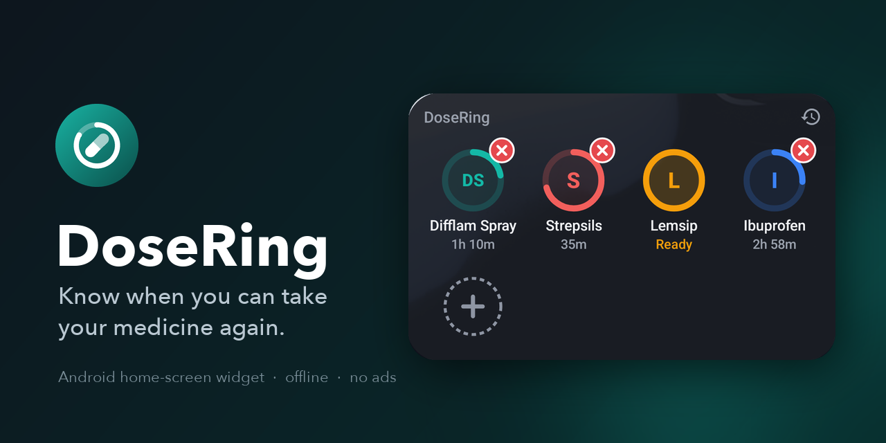
</p>

<p align="center">
  <a href="https://github.com/Nik-Kras/DoseRing/actions/workflows/ci.yml"></a>
  <a href="https://github.com/Nik-Kras/DoseRing/releases/latest"></a>
  
  
  
  <a href="LICENSE"></a>
</p>

**DoseRing** is a home-screen widget for the medicines you take "every few hours": throat sprays, lozenges, cold remedies, painkillers. Tap a medicine when you take it and a ring starts filling around it. When the ring is full, you can take it again.

It was built for a week with a bad cold: Difflam every 1½ hours, Strepsils every 2, Lemsip and ibuprofen every 4. It is hard to remember which one was when.

<p align="center">
  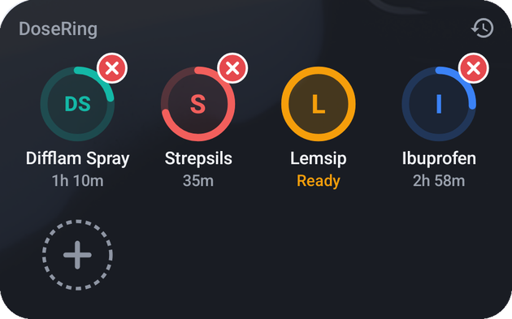
  &nbsp;
  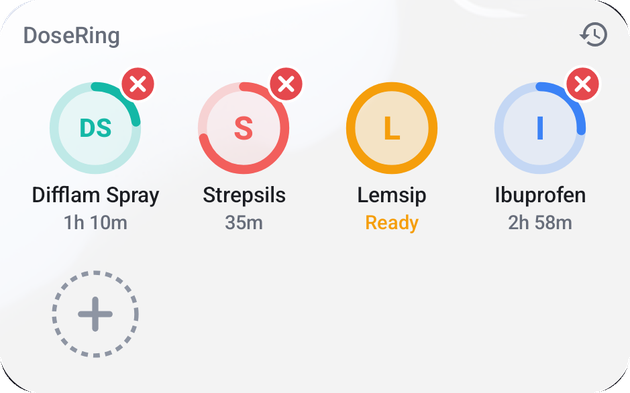
</p>

## Install


Scan the QR code with your phone's camera, or download **[DoseRing.apk](https://github.com/Nik-Kras/DoseRing/releases/latest/download/DoseRing.apk)** from the [latest release](https://github.com/Nik-Kras/DoseRing/releases/latest).

1. Open the downloaded `DoseRing.apk`. When Android asks, allow your browser to **install unknown apps**.
2. If Play Protect warns about an unknown developer, choose **More details → Install anyway**.
3. On Samsung phones with **Auto Blocker** enabled (*Settings → Security and privacy → Auto Blocker*), switch it off while installing.
4. Open DoseRing and tap **Add widget**. You can also long-press the home screen, choose **Widgets** and pick **DoseRing**.

Requires Android 12 or newer. Updates install over the existing app and keep your data.

## Features

- **One-tap logging from the home screen.** Tap a medicine to log a dose. The ring restarts and fills over the interval you set, with the time left shown underneath.
- **Full ring means ready.** When the interval has passed, the ring closes, the tile says **Ready**, and you get a notification with a **Take now** button.
- **Guards against double dosing.** Tapping a medicine early, or past its optional 24-hour limit, asks for confirmation and shows why.
- **Undo a mis-tap.** The red ✕ on a running timer removes that intake from the journal after an "Are you sure?" prompt. The timer resets.
- **Nameless "+" tile.** Tap it to add a medicine: name, time between doses, dose per tap (mg, ml, sprays, tablets, lozenges…), an optional daily limit and a ring colour.
- **Journal.** Every dose, grouped by day. Entries can be deleted.
- **Statistics.** Doses per day over the last 7 or 30 days, per-medicine totals for each day, and a 24-hour view against your limits.
- **Resizable widget.** Tiles reflow to fit any size. Follows light and dark mode.
- **Private by design.** No account, no ads, no analytics, and no internet permission at all. Everything stays on the phone.

## Screenshots

| Widget | Early dose | Undo a dose | Add a medicine |
|:---:|:---:|:---:|:---:|
| 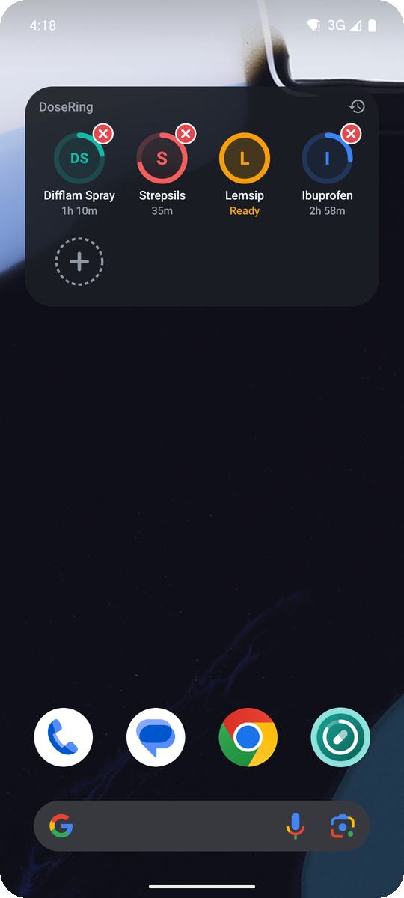 | 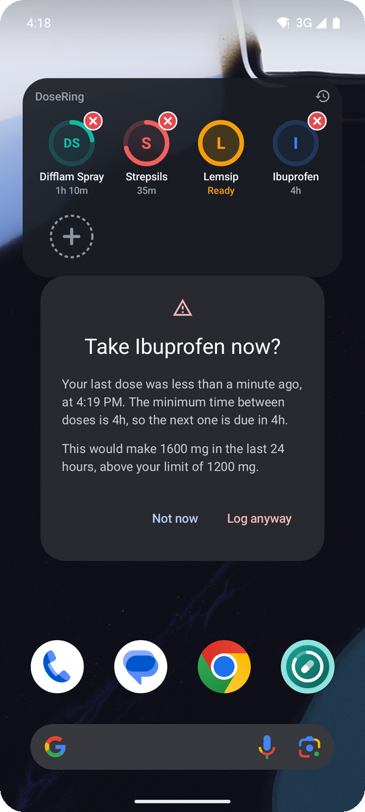 | 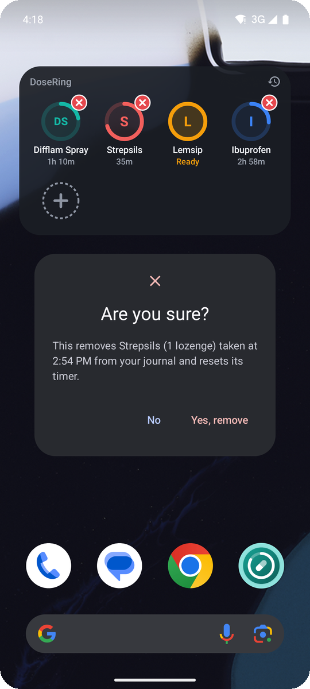 | 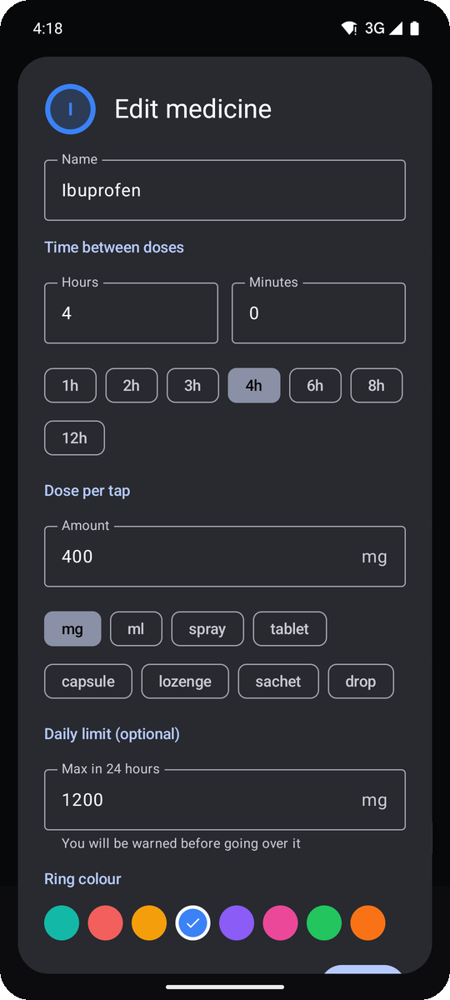 |
| **Medicines** | **Journal** | **Statistics** | **Light mode** |
| 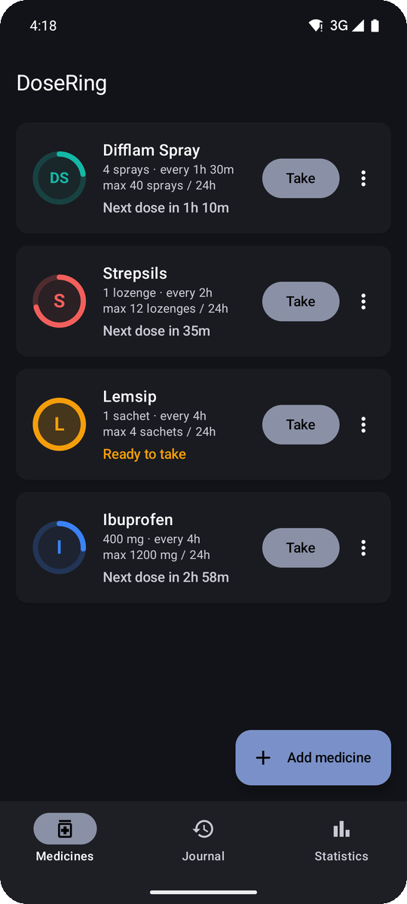 | 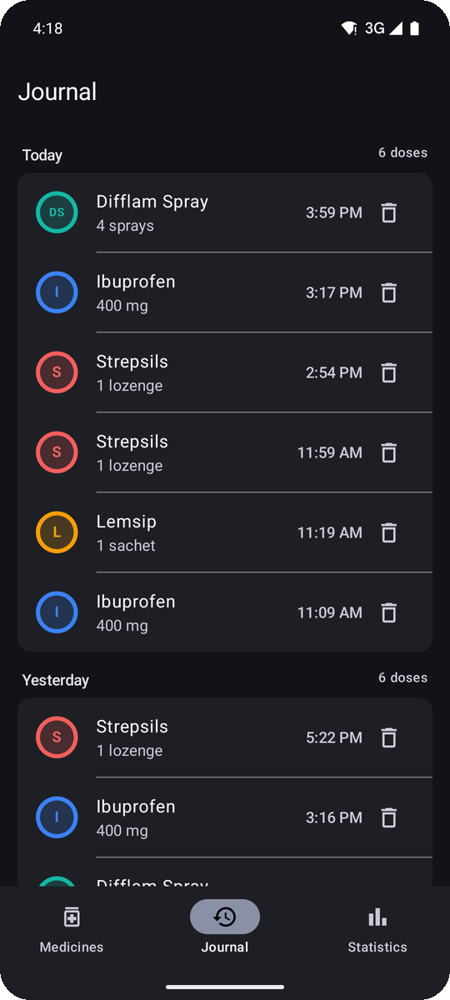 | 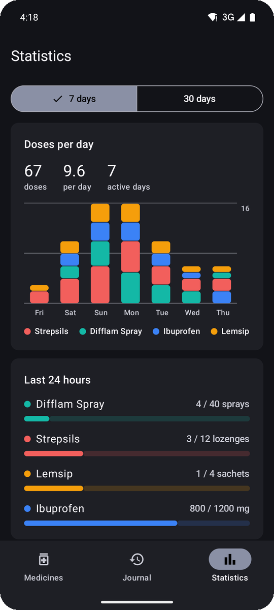 | 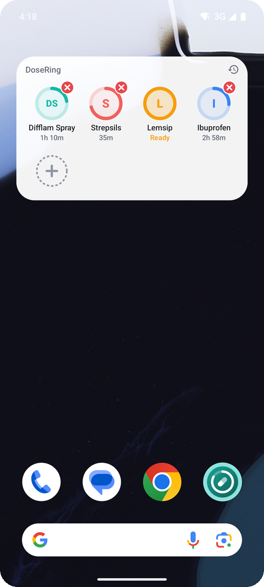 |

## How a tap works

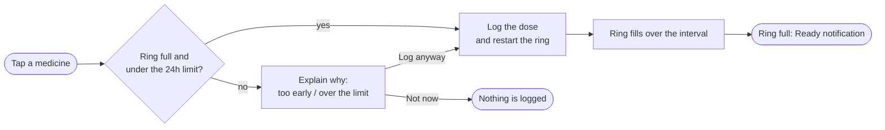

## Architecture

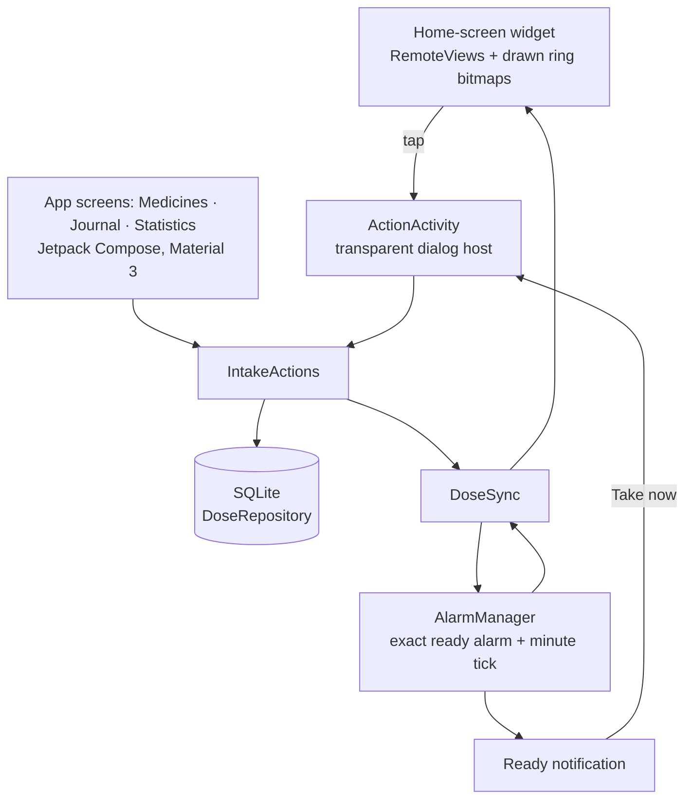

- **Widget:** a classic `AppWidgetProvider` with a `GridView` collection (`RemoteCollectionItems`). Rings are drawn into bitmaps by `RingRenderer` using only the medicine's colour, so they look right on light and dark home screens.
- **Timing:** each medicine gets an exact "ready" alarm. While any ring is filling, a non-wakeup alarm redraws the widget at the start of every minute. It costs nothing while the screen is off and catches up as soon as the phone wakes. Alarms are re-armed after reboots, app updates and clock changes.
- **Taps:** widget taps open a transparent activity. A tap on a ready medicine logs the dose and closes instantly. Anything that needs a decision shows a Material 3 dialog over the home screen.
- **Data:** stored in a local SQLite database. Each intake keeps a snapshot of the medicine's name, dose and colour, so the journal stays accurate after a medicine is edited or deleted.
- **Domain logic:** ring progress, the 24-hour window, dose formatting and daily statistics live in plain Kotlin with no Android dependencies, and are unit-tested.

## Build from source

Requirements: JDK 17 and the Android SDK (platform 35).

```sh
git clone https://github.com/Nik-Kras/DoseRing.git
cd DoseRing
./gradlew testDebugUnitTest   # unit tests
./gradlew installDebug        # build and install on a connected device or emulator
```

Debug builds include a demo-data receiver, which is how the screenshots above were produced:

```sh
adb shell am broadcast -n com.nikkras.dosering/.debug.DemoSeedReceiver                  # a week of a cold
adb shell am broadcast -n com.nikkras.dosering/.debug.DemoSeedReceiver --ez empty true  # wipe all data
```

Release builds are signed with a key read from an untracked `keystore.properties`:

```properties
storeFile=/path/to/release.jks
storePassword=…
keyAlias=…
keyPassword=…
```

## Project structure

```
app/src/main/java/com/nikkras/dosering/
├── data/          SQLite schema, models and repository
├── domain/        Pure Kotlin: ring progress, 24h limits, dose formatting, statistics
├── widget/        AppWidgetProvider, RemoteViews builder, ring bitmap renderer
├── alarm/         Ready alarms, minute ticks, reboot/update/time-change handling
├── notify/        "Ready to take" notifications
├── ui/            ActionActivity (widget dialogs), MainActivity, Compose screens and theme
├── DoseSync.kt    Keeps widgets, alarms and open screens in step with the database
└── IntakeActions.kt
app/src/debug/     Demo-data receiver for screenshots
app/src/test/      Unit tests for the domain logic
```

## Disclaimer

DoseRing is a personal reminder tool, not a medical device. Always follow the dosing instructions on the packaging or from your pharmacist or doctor. Intervals and limits are only as accurate as what you enter.

## License

[MIT](LICENSE) © 2026 Nikita Krasnytskyi
